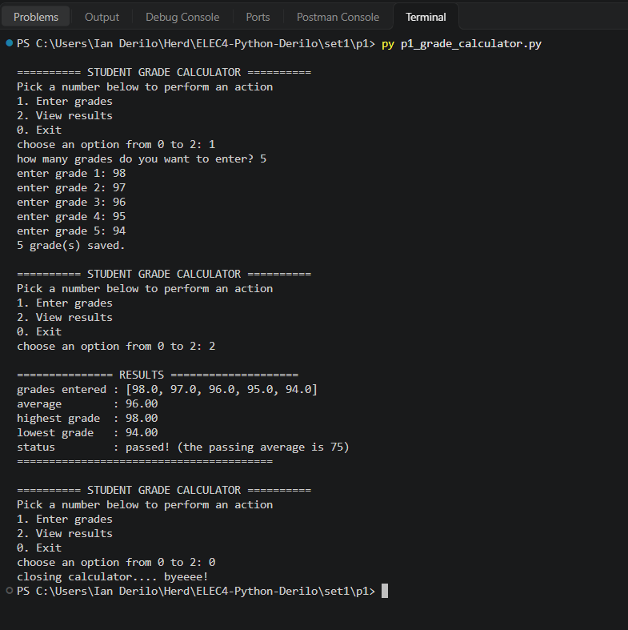

# ELEC 4 – Python Programming

**Name:** Ian Gabriel S. Derilo
**Section:** IV-BSIT-B
**Course:** ELEC 4 – Python Programming
**Instructor:** Carl Gustaf Patrik B. Ferrer

## Activities

| Activity | Description | Folder | How to run |
| --- | --- | --- | --- |
| P1: Student Grade Calculator | A program built from functions that computes the average, highest, lowest and pass/fail status | [set1/p1](set1/p1) | `py set1/p1/p1_grade_calculator.py` |
| P2: Custom module student_utils | A module imported by a program that prints a grade report with the date and time | [set1/p2](set1/p2) | `py set1/p2/p2_main.py` |
| P3: Student Record Manager | | | |
| P4: Safe Menu Program | | | |
| P5: Student Information File System | | | |
| P6: Recursion Toolkit | | | |
| P7: Student Management System with Classes | | | |
| P8: Inheritance and Polymorphism | | | |

## Screenshots

### P1: Student Grade Calculator

### P2: Custom Module student_utils
